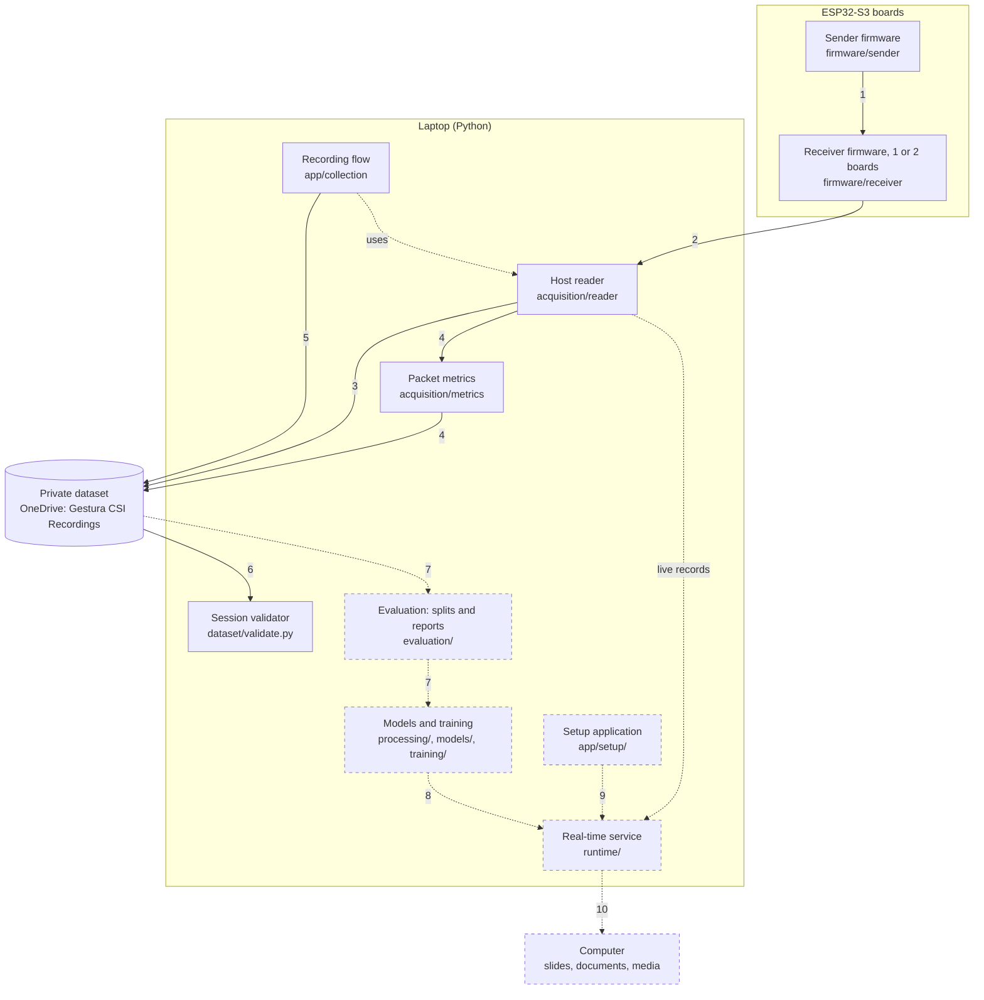

# Architecture overview (v1)

Jira: GES-76. State on 28 November 2026 (end of Sprint 4): `main` at 22ce92c, plus the session validator in PR #13.

This page shows the parts of Gestura, the data that passes between them, and which parts are built. The data
formats are defined in [`csi-session-contract-v1.md`](csi-session-contract-v1.md) (schema 1.0.0); this page only
points to them. The risk register and the mapping of Jira stories to technical items are in
[`implementation-risks.md`](implementation-risks.md).

## Diagram

Solid: built (the validator is in review). Dashed: planned. The numbers refer to the interface table below.

## Components

| Component | Code | Jira | Status |
|---|---|---|---|
| Sender firmware | `firmware/sender` | GES-68 | Built. Checked on boards by three members. |
| Receiver firmware | `firmware/receiver` | GES-68 | Built. Checked with one receiver; a second receiver board has not been tested. |
| Host reader | `src/gestura/acquisition/reader` | GES-69 | Built. One receiver checked on boards; two receivers checked only with synthetic ports. |
| Packet metrics | `src/gestura/acquisition/metrics` | GES-70 | Built. Compares each receiver with NFR-09. |
| Recording flow | `src/gestura/app/collection` | GES-71 | Built for dry runs with synthetic receivers. Not yet connected to the host reader, so no session has been recorded from real receivers. |
| Session validator | `src/gestura/dataset/validate.py` | GES-72 | In review (PR #13). |
| Private dataset | OneDrive folders (contract Section 4) | GES-67, GES-73 | Layout and procedure defined. No participant session recorded yet. |
| Evaluation | `src/gestura/evaluation` | GES-74 | Planned. The split protocol is in [`evaluation-splits-v1.md`](evaluation-splits-v1.md); the split code and reports (F5.1–F5.3) are later work. The current scripts in this folder are feasibility analyses. |
| Models and training | `src/gestura/processing`, `models`, `training` | – | Planned (F3.1, F3.2). Training and the real-time service share the preprocessing code. |
| Real-time service | `src/gestura/runtime` | – | Planned (F4.1, F4.2). |
| Setup application | `src/gestura/app/setup` | – | Planned (F2.2–F2.5). |

The feasibility scripts in `src/gestura/acquisition` (`test.py`, `record_*.py`, `check_signal.py`) are earlier
tools. They are not part of this pipeline; `bip.py` is reused by the recording flow for the cue tones.

## Interfaces

| # | From → to | Data | Defined in |
|---|---|---|---|
| 1 | Sender → receiver | ESP-NOW broadcast from `1a:00:00:00:00:00` on channel 11, 20 MHz, MCS0; 100 packets/s configured, about 90/s measured. Each packet carries the sender's `uint32` sequence number `id`. | [`firmware/README.md`](../firmware/README.md) |
| 2 | Receiver → host reader | USB-to-UART (CH343) at 921600 baud, 8N1: a banner, a header row, then one `CSI_DATA` line with 25 fields per packet. The gain is fixed after the first 100 packets. | Contract Section 1 |
| 3 | Host reader → dataset | `receivers/<receiver_id>.ndjson`: one JSON record per accepted packet (host time, host monotonic time, the 25 fields, `raw_line`). `events.ndjson`: malformed lines, restarts, configuration changes, disconnects and stalls. Receivers are identified by USB serial number from `data/receivers.json` (not committed). | Contract Section 2 |
| 4 | Host reader → packet metrics → dataset | Records and events, either live through callbacks or by replaying a capture folder. Output: `packet_metrics` per receiver in `session.json`. | Contract Section 2; [metrics README](../src/gestura/acquisition/metrics/README.md) |
| 5 | Recording flow → dataset | `session.json` (created before capture, completed after) and `trials.csv` (label and cue times for each trial). | Contract Section 3 |
| 6 | Dataset → validator | A session folder, a `sessions/` folder or the dataset root. Output: errors, warnings and info for each file and field. | [dataset README](../src/gestura/dataset/README.md) |
| 7 | Dataset → evaluation → training | Complete sessions grouped by `recording_date`, `participant_code` or `room_id`. Sessions with `room_role: final_demo` are never used for training. | [`evaluation-splits-v1.md`](evaluation-splits-v1.md) |
| 8 | Training → real-time service | Planned: the selected model and a confidence threshold chosen on validation data (F4.1). | To be defined |
| 9 | Setup application → real-time service | Planned: the active mode, the gesture-to-command mapping, and start or pause listening (F2.3–F2.5). | To be defined |
| 10 | Real-time service → computer | Planned: the key command of the recognized gesture in the active mode (F4.2). | To be defined |

**Clocks.**
- Packets and trial labels are matched by `host_monotonic_ns`. It is the one host clock that both the reader and
  the recording flow use.
- The receivers' `local_timestamp` is not synchronized between boards and wraps about every 71.6 minutes.
- UTC times are for people to read.
- The sender `id` pairs the same packet across two receivers.

## Where data is kept

| Place | Contents |
|---|---|
| This repository (public) | Code, documents, synthetic fixtures in `tests/fixtures/` |
| `data/` on each laptop (ignored by git) | `receivers.json`, board captures, dry runs |
| OneDrive `Gestura CSI Recordings` (team only) | Session folders of real recordings |
| OneDrive `Gestura Signed Consent` (team only) | Consent forms, the list of participant codes and names, the room list |
